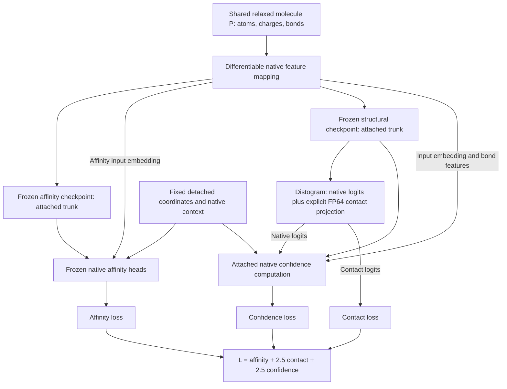

# DBMol-style Boltz-2 loss: implementation, gradients, validation and pitfalls

Reviewed against repository code and saved HPC evidence on **23 October 2026**.
This is the consolidated implementation reference. The older numbered studies
remain the historical record; their dated “pending” statements are not current
status. This documentation change runs no models and changes no objective,
gate, checkpoint, job or sealed experiment.

**What works:** the affinity/contact/confidence objective supplies gradients
through frozen Boltz modules into the shared relaxed graph and, in the tested
runner, through a frozen decoder into molecular `z`. Targeted native readiness
and optimization runs passed the explicitly named **pointwise native AD v4**
contract. **What that does not establish:** universal whole-network finite-
difference agreement, a derivative through diffusion or changing atom count,
chemical validity, or improved binding of a discrete molecule.

## Contents

1. [Boundary and forward/backward flow](#1-boundary-and-forwardbackward-flow)
2. [Exact loss definitions](#2-exact-loss-definitions)
3. [Relaxed graph to native features](#3-relaxed-graph-to-native-features)
4. [Frozen modules, coordinates and confidence](#4-frozen-modules-coordinates-and-confidence)
5. [Precision and gradient-validation history](#5-precision-and-gradient-validation-history)
6. [Step acceptance and optional DeFoG guidance](#6-step-acceptance-and-optional-defog-guidance)
7. [Configuration and reuse](#7-configuration-and-reuse)
8. [Code and test map](#8-code-and-test-map)
9. [Evidence and scientific limits](#9-evidence-and-scientific-limits)
10. [Maintenance checklist](#10-maintenance-checklist)

## 1. Boundary and forward/backward flow

Start with **one relaxed molecular graph** `P = {a_i, c_i, b_ij}`: categorical
atom, formal-charge and bond probabilities. Each distribution sums to one;
bonds are symmetric, and self/absent pairs are `NONE`. The graph must match a
prepared complex's exact occupied slots. There is no need for a VAE in this
definition; the existing optimization driver happens to obtain `P` from one.



The solid arrows show the forward calculation. Reverse AD carries derivatives
from `L` back along the differentiable arrows to `P`. It does **not** update the
frozen model weights or the fixed context. For the existing latent driver:

```text
forward:   z -> frozen decoder -> P -> native features -> two frozen trunks -> L
backward:  dL/dz = (dP/dz)^T (dfeatures/dP)^T (dL/dfeatures)
```

Here “two trunks” is literal: the affinity checkpoint retains its trained
trunk; the structural checkpoint retains its own trunk. Contact and confidence
share the latter. A single composite scorer call is not one physical trunk
execution. The `z` variable inside Boltz's trunk code is a **pair tensor**,
not the molecular latent vector also conventionally called `z`.

The central implementation is
[`FrozenBoltzDBMol.forward`](../src/latentmol/boltz/dbmol_model.py#L212).
The current relaxed graph is evaluated directly: no molecule argmax, hard
sampling, RDKit repair or SMILES conversion occurs inside this branch.

## 2. Exact loss definitions

The opt-in profile is `dbmol_fixed_pose_v1`. Its terms follow DBMol v1 section
3.2, equations 2–6 and Appendix C.1, as recorded in the
[original implementation study](36_dbmol_composite_objective.md) and local
[paper](DBMol.pdf). Fixed-pose adaptation, numerical precision, ensemble-logit
aggregation, epsilon and distance-bin representatives are explicit repository
choices. This is **DBMol-style**, not a certificate of identical upstream code
or an exact reproduction of all paper experiments.

### Affinity: no desired target value and no MSE

Minimize the native continuous prediction and maximize the raw binder logit:

```text
r = mean of native affinity_pred_value over affinity ensemble members
h = mean of native affinity_logits_binary over ensemble members
L_affinity = w_regression * r - w_logit * h
default w_regression = w_logit = 1
```

No target affinity is supplied. The sign is the implemented native/paper
convention; do not reinterpret `r` as a generic “higher is better” affinity
unit and reverse its sign without a declared objective change.

[`native_heads`](../src/latentmol/boltz/model.py#L145) also reports
`affinity_probability_binary = mean(sigmoid(member_logit))`. The loss uses
the **mean raw logit**, not that probability, `sigmoid(mean(logits))`, or
`logit(mean(sigmoid(logits)))`. These are different ensemble quantities.
Using logits avoids adding a sigmoid saturation factor to the binder term's
derivative, but does not guarantee a large or useful input gradient.

### Contact: pocket coverage plus strongest anchor

For pocket protein token `i` and occupied ligand token `j`:

```text
q_ij = sum softmax(distogram_ij)[k] over bins with representative distance < 8 Å
e_ij = -log(q_ij + epsilon)                     epsilon = 1e-8
L_pocket = mean_i min_j e_ij
L_anchor = min_(i,j) e_ij
L_contact = (L_pocket + L_anchor) / 2
```

[`contact_loss`](../src/latentmol/boltz/dbmol_objective.py#L164) computes the
categorical mass in log space using `log_softmax`/`logsumexp`, then adds epsilon
with `logaddexp`. Epsilon is additive, not a probability clamp. It stabilizes
tiny masses but can attenuate their gradients; it is not a chemical prior.
The `min` operations retain native piecewise derivatives and can change their
winning pairs. Detached diagnostics record per-residue winners, the anchor
pair and the smallest best-versus-second margin; diagnostics do not replace
the differentiable minima. Only protein-to-ligand orientation is reduced.

The pinned head has **64 bins**, with 63 boundaries spanning 2–22 Å. Interior
representatives are midpoints; outer representatives extrapolate half a bin.
`native_64_midpoint_lt_cutoff` uses strict `< cutoff`. Representatives are
constructed in the **original native head dtype before widening**, preserving
membership at a boundary. See
[`native_bin_centers`](../src/latentmol/boltz/dbmol_objective.py#L149).

The pocket is selected once: protein residues having a heavy atom strictly
within 8 Å of the initial reference ligand's heavy-atom pose, or an explicitly
provided residue list. Freeze native `(asym_id, residue_index)` identities,
prepared-file SHA and context digest. These are **native tensor indices**, not
PDB author numbering. Do not recompute the pocket from optimized states.
[`initial_pose_pocket`](../src/latentmol/boltz/dbmol_prepare.py#L13) performs
selection outside autograd;
[`pocket_token_mask`](../src/latentmol/boltz/dbmol_objective.py#L132) resolves
the identities while excluding padding. Missing, ambiguous, empty or overlapping
masks fail. An initial-pose pocket is an engineering choice, not biological
validation of the binding site.

### Confidence: six native quantities with signed weights

```text
L_confidence = -1.0 * iptm
               -0.3 * complex_iplddt
               +0.3 * complex_ipde
               +0.1 * complex_pde
               -0.3 * confidence_score
               -0.1 * ptm

confidence_score = (4 * complex_plddt + tm) / 5
tm = iptm, unless native torch.allclose(iptm, zeros_like(iptm)) selects ptm
```

These use native reductions and scales. The approximately-zero interface rule
is a native aggregation convention, not permission to substitute for a missing
or malformed interface. Missing/non-scalar terms raise errors; nonfinite scalar
terms raise `NonfiniteObjective`. The code never silently drops a term.

### Assembly and reporting

[`reduce_objective`](../src/latentmol/boltz/dbmol_objective.py#L242) applies:

```text
dbmol_total_loss = L_affinity + 2.5 * L_contact + 2.5 * L_confidence
```

Store the primitives, unweighted components and `dbmol_weighted_*` values.
The 2.5 coefficients do **not** equalize magnitudes or gradient norms. Opposing
derivatives can cancel; a small total gradient does not mean each term is small.
Do not apply another 2.5 in an outer runner or confuse this with historical
binary-affinity-only loss. In guided runs, this total is the **binding loss**;
repair guidance is added separately.

## 3. Relaxed graph to native features

[`adapt_graph`](../src/latentmol/boltz/adapter.py#L16) modifies only mapped ligand
rows of a `PreparedComplex`; receptor/cross features and remaining auxiliary
features are retained. The baseline transformation is:

| Graph information | Native representation | Consequence |
| --- | --- | --- |
| Atom distribution | `ref_element = sum_x a_ix * one_hot(atomic_number_x, 128)` | Uses atomic numbers, not decoder class indices. |
| Charge distribution | `ref_charge = sum_q c_iq * formal_charge_q` | Only the mean survives; different distributions can be indistinguishable. Soft charges require explicit lossy-input permission. |
| Bond existence | `token_bonds = 1 - b_ij[NONE]` | Probability of any bond, **not** expected bond order. |
| Bond type | Map graph categories to seven native IDs, then `sum_t p_t * embedding[t]` | Includes the `NONE` embedding. Native IDs are NONE=0, OTHER=1, SINGLE=2, DOUBLE=3, TRIPLE=4, AROMATIC=5, COVALENT=6; the graph schema supports only its declared subset. |

The typed expectation is used in the trunk **and** the attached confidence
module where that native bond feature is enabled. The current helper is
[`bond_type_embedding`](../src/latentmol/boltz/embedding_injection.py#L229);
outside an explicitly scoped experimental injection context its expression is
exactly `bond_probabilities @ module.token_bonds_type.weight`.

**Do not call this an ensemble expectation of predictions:** generally
`Boltz(E[features]) != E[Boltz(hard molecule)]`. Fractional inputs are an
extension beyond hard training inputs and can be exploited by optimization.
Hard-input parity alone does not establish scientific fidelity everywhere in
the relaxed simplex.

### Occupancy and representation limits

[`fixed_occupancy_graph`](../src/latentmol/graph_policy.py#L14) applies softmax
to **raw real-element logits after excluding NO_ATOM**, at one shared
temperature, then imposes the selected mask. Absent slots become NO_ATOM with
neutral charge; absent/self bonds become one-hot NONE. Conditioning after the
ordinary soft-occupancy graph would leave bonds spuriously attenuated.

This policy intentionally gives NO_ATOM logits **no binding gradient**. The
validated v4 experiments keep the initial mask fixed. Historical active-set
code can select a different prepared count context between steps, but those
discrete switches do not have atom-birth/death derivatives and are not covered
by the fixed-mask v4 certificate. Do not infer variable-size validation from it.

[`BoltzGraphBranch.assess`](../src/latentmol/boltz/scoring.py#L117) checks batch
one, declared schema, common device, finite normalized distributions, exact
occupancy, symmetric bonds, NONE on self/absent pairs and neutral padding.
The native interface additionally assumes one atom per ligand token and an
authenticated slot-to-atom/token map. It does not rematch slots from a SMILES.
Shape/representation compatibility is distinct from chemical validity.

## 4. Frozen modules, coordinates and confidence

The pinned native Boltz commit is
`b1ebfc46ecf57f5414e0d1a6f9027bbb122c53bc`; asset constants live in
[`contracts.py`](../src/latentmol/boltz/contracts.py#L11). The tested affinity
checkpoint SHA is
`dcc5cd3722b1c9eaa34267e4ae32f55cbbf1963f4c19319381ccfa30fdd2ca9e`;
the structural checkpoint in the cited runs has SHA
`090e82ac8c92f5e943fa1b39e7410a44027bea7243c0bbb3caa67a77fc1428e1`.
The latter is explicitly supplied and authenticated in the profile.

Stock eval inference disables trunk autograd and detaches affinity/confidence
inputs. Simply setting an input's `requires_grad` on the stock top-level
inference call is insufficient. Our
[`attached_trunk`](../src/latentmol/boltz/model.py#L176) executes the pinned native
recurrence with input autograd attached. Models remain `eval()` and
`requires_grad_(False)`; **frozen weights do not prohibit input gradients**.

Affinity uses receptor–ligand and ligand–ligand masked pair states plus a
separate native affinity input embedding. Preserve both derivative paths.
Never apply this affinity mask to the structural trunk's pair state.

Coordinates are supplied as a **detached cached pose** to the native heads.
The wrapper does not invoke diffusion during scoring; it is not merely taking
a scalar immediately before diffusion. The native affinity and confidence
modules also bin geometric distances discretely. Removing `.detach()` alone
would not create an ordinary useful pose derivative through those bin indices.
Diffusion is not inherently impossible to differentiate; this method deliberately
bypasses it for cost/scope. The derivative is
`partial L / partial chemistry at fixed pose/context`, not a total derivative
including ligand/protein rearrangement.

[`attached_confidence`](../src/latentmol/boltz/dbmol_model.py#L104) mirrors the
native batch/multiplicity-one module while retaining input derivatives and
replacing typed bond lookup by its expectation. Never transplant confidence
heads onto the separately trained affinity trunk. Strict loaders authenticate
checkpoints, use `strict=True`, disable compile/custom kernels and apply explicit
native CLI runtime overrides rather than discarding arbitrary unknown keys.
Molecular-weight correction is disabled: the initial weight would become stale
when elements change. MSA resampling is disabled to retain the saved subset.

[`validate_frame_context`](../src/latentmol/boltz/dbmol_model.py#L51) and
[`strict_confidence_scores`](../src/latentmol/boltz/dbmol_model.py#L143) reject
unsupported layouts before native frame helpers can swallow an assignment
exception. They support the native single-ensemble `[B,1,T,3]` frame indices
and legacy `[B,T,3]`, with prefix padding, valid indices, sorted contiguous
chain axes and a nondegenerate interface. Multi-ensemble layouts are not
silently flattened. The correct categorical edge diagonal is one-hot NONE,
not an all-zero vector.

Activation memory is controlled by
[`checkpoint_eval_block`](../src/latentmol/boltz/model.py#L22) and
[`install_eval_checkpoints`](../src/latentmol/boltz/model.py#L52): non-reentrant
block rematerialization preserves frozen eval parent behavior and RNG state.
Do not switch the model to training mode just to enable its native checkpoint
flags. Rematerialization repeats forward work during backward; count that cost.

## 5. Precision and gradient-validation history

### The adopted arithmetic is an explicit change

Three policies remain distinct:

| `objective_arithmetic` | Calculation |
| --- | --- |
| `native_v1` | Original native head/reduction arithmetic. |
| `contact_and_assembly_float64_v1` | Widen already-computed contact logits and scalar assembly; cannot recover prior rounding. |
| `contact_head_and_assembly_float64_v1` | Widen the structural final pair state **before symmetrization and the frozen affine distogram projection**, then contact reduction and scalar assembly. Adopted by the cited v4 runs. |

[`contact_distogram_float64`](../src/latentmol/boltz/contact_projection.py#L14)
implements the last policy and rejects unsupported head layouts. Trunks and
stored weights remain FP32; confidence still receives its original native
distogram logits. Only the contact branch receives the separate FP64 logits.
The bin partition stays native-defined. Repair NLL remains native arithmetic.
This is neither a whole-network FP64 conversion nor a change to trained weights.

### What the investigations actually found

The full evidence table is in
[docs56](56_existing_gradient_evidence_review.md); the precision intervention is
in [docs54](54_contact_precision_and_branch_validation.md). Key lessons:

- Decoder absolute-value branches and affinity readout ReLUs can switch across
  finite-difference endpoints. At an authenticated guided affinity state, AD
  was 4.07505941 versus a natural secant 4.54388559 at epsilon 0.0001; holding
  baseline readout branches **for diagnosis only** gave 4.07414864. This explains
  that interval, not every later failure.
- Contact's pocket and anchor slopes can oppose each other. One investigated
  state showed roughly fivefold cancellation amplification. Widening only a
  rounded scalar cannot repair upstream FP32 resolution; widening the final
  contact projection helped the targeted contact checks.
- Exact chained VJPs across inspected boundaries, repeated forwards and
  grad/no-grad comparisons did not reveal a missing path in those states.
  Proposed wholly masked attention rows were excluded for the tested cases.
  Later contact/combined secant residuals were **not uniquely localized to one
  upstream operation**. Do not describe this history as a single proven bug
  fixed by clipping.
- Some failures were real engineering bugs: GPU child-process admission,
  native frame shape and categorical diagonal assumptions. These are separate
  from Boltz derivative checks. DeFoG workers successfully producing targets
  does not imply Boltz's finite-difference gate passed, and vice versa.

### The successful contract: `pointwise_native_ad_v4`

Despite the historical config key `fd_policy`, this contract's mandatory
full-path derivative test is **local native forward/reverse AD agreement**,
not whole-network finite-difference agreement. The scope is explicit in
[docs57](57_pointwise_gradient_validation.md), implemented by
[`validate_branch_derivatives`](../src/latentmol/boltz/pointwise_ad.py#L51)
and independently read by
[`verify_gate`](../src/latentmol/boltz/pointwise_contract.py#L212).

1. Authenticate source/assets/context and hard-seed native parity. Require
   repeatable native primal/shared graph, unchanged frozen state, and attached,
   finite, nonzero component and combined gradients.
2. Compare reverse-AD directional products against native forward-mode dual
   tensors through the actual path, with four analytically preselected
   directions per objective. JVP tolerances are `rtol=1e-3`, `atol=1e-6`.
   Forward AD runs under `no_grad` to bypass reverse activation checkpoints;
   this does not disable forward AD. No double-backward substitute or
   outcome-selected replacement direction is used.
3. Recompose components and the complete objective from their live primitives,
   retaining dtype, grouping and the FP32 repair-coefficient product. Require
   exact scalar, reverse-vector and forward-tangent agreement. Adding separately
   rounded gradient vectors is not an exact recomposition proof.
4. Independently audit graph-to-feature mapping with manual expectations and
   an FP64 affine-cut value/JVP/VJP/finite-difference check. See
   [`validate_bridge`](../src/latentmol/boltz/pointwise_cuts.py#L132).
   This is a numerical **bridge** check, not a full Boltz FD certificate.
5. Retain prescribed natural secants as non-gating landscape observations
   (`required_for_pass: false`). Keep every historical v1/v2/v3 failure;
   a v4 pass cannot retroactively certify those policies.

Both AD methods can share an unintended detach. Their agreement alone is
insufficient; the independent bridge/source audit, hard-input parity, explicitly
fixed channels and natural-objective step checks are complementary evidence.
Native ReLU/abs/min subgradient conventions remain unchanged; no branch is
held during optimization. The tested contract is fixed initial occupancy,
zero recycles, declared contact-head FP64 arithmetic and bounded steps. It
does not prove every Jacobian direction, smoothness across a finite interval
or generalization to another checkpoint, precision, recycle count or interface.

## 6. Step acceptance and optional DeFoG guidance

Gradient validation and step acceptance answer different questions. Clipping
limits a proposed displacement; it does not fix a detached path, establish a
correct derivative or prove that the new actual scalar improves.
[`projected_proposal`](../src/latentmol/optimization.py#L107) clips, scales and
projects into a trust ball **centered on the initial latent**, not each current
point. [`backtracking_step`](../src/latentmol/optimization.py#L151) evaluates the
actual objective while holding context, mask, target and coefficient fixed.

- Historical source109/source120 used **`armijo_v1`**: bounded sufficient
  decrease with an observation/ULP margin. A legitimate lack of an accepted
  trial can stall; it is not convergence or full-budget completion.
- Future **`best_trial_v2`**: take a nonincreasing full step immediately;
  otherwise try successive halves through `2^-15`, accept the first strict
  improvement, or take the earliest lowest-loss finite candidate. Loss can
  rise and a rounded no-op can consume an update. Report applied, improving,
  fallback and no-op counts separately. All-nonfinite trials and failed native
  gates remain failures. Its CPU fixtures passed; do not borrow historical
  Armijo runs as native validation of v2. See [docs62](62_full_budget_best_trial_optimization.md).

DeFoG guidance is **outside** the DBMol binding objective. The frozen provider
samples hard graphs and performs declared candidate-start denoising, then
checks representation/chemical validity, fixed count and slot alignment.
An accepted target `H` is detached and held fixed:

```text
L_repair(P; H) = -sum_i log a_i[x_i^H]
                -sum_i log c_i[q_i^H]
                -sum_(i<j, occupied) log b_ij[e_ij^H]
L_optimization = dbmol_total_loss(P) + lambda * L_repair(P; H)
```

[`fixed_target_nll`](../src/latentmol/repair_guidance/loss.py#L49) uses stable
log-softmax from the **same** decoder logits/temperature/mask, counts each
undirected pair once including NONE, and supports `sum` or mean over
`2K + K(K-1)/2` decisions. The cited long experiment used `sum`; its weight
cannot be compared to a mean-normalized weight without accounting for this.
Boltz always scores **current `P`**, not repaired `H`. There is no derivative
through the hard draw, DeFoG trajectory or target selection, and this is not
DeFoG likelihood or an exact validity gradient.

The long-run target refreshed every five updates, with four prescribed attempts
and first eligible selection. Its coefficient was 0.001 through update 12,
then linearly ramped to 0.1 at update 24 and held there (zero-based update
indices; the original first-25-update schedule). Failed refreshes clear the
target and contribute **no repair term** under that historical protocol.
Thus configured lambda is not proof of active guidance. Keep target presence,
applied weight, unweighted/weighted loss, gradient norms/cosine and refresh
receipts visible. Totals across changing targets/weights are different
objectives; compare the separately recorded fixed-context binding component.

The GuacaMol DeFoG checkpoint has specific element/bond/charge limits; strict
neutral handling and explicit lossy charge projection are distinct modes.
Do not silently neutralize a graph or claim both models take exactly the same
native input. Details and failures remain in
[docs37](37_defog_repair_guidance.md),
[docs48](48_defog_comprehensive_diagnosis.md) and
[`DeFoGRepairProvider`](../src/latentmol/repair_guidance/provider.py#L81).
The separate chemistry loss used for VAE training is not automatically part
of this Boltz/DeFoG objective.

## 7. Configuration and reuse

For the tested direct active-set runner, explicitly pair:

```yaml
arms: [fixed_initial_mask]
recycling_steps: 0
fd_policy: pointwise_native_ad_v4
objective:
  output: dbmol_total_loss
  direction: minimize
  weight: 1.0
  scale: 1.0
  offset: 0.0
dbmol:
  profile: dbmol_fixed_pose_v1
  objective_arithmetic: contact_head_and_assembly_float64_v1
  affinity_regression_weight: 1.0
  affinity_logit_weight: 1.0
  contact_weight: 2.5
  confidence_weight: 2.5
```

This is a **settings fragment**, not a complete runnable job. Supply all six
confidence weights, authenticated structural/affinity/decoder assets, prepared
contexts, fixed pocket/reference, shared temperature, initial-state identity,
explicit step policy, diagnostics and execution budget. The parser is
[`ActiveSetConfig.load`](../src/latentmol/boltz/active_set.py#L83);
[`DBMolObjectiveConfig.from_mapping`](../src/latentmol/boltz/dbmol_objective.py#L63)
validates the inner profile. Omitting `objective_arithmetic` preserves
`native_v1`; it does not opt into the successful changed precision automatically.

Inspect an actual saved
[source120 control config](../outputs/hpc-results/source120a004-staged-003/submissions/source120a004-boltz-defog-staged-24h-attempt004/readiness/prepared/boltz_only.yaml)
and
[guided config](../outputs/hpc-results/source120a004-staged-003/submissions/source120a004-boltz-defog-staged-24h-attempt004/readiness/prepared/boltz_defog.yaml)
for historical resolved settings. Do **not** submit these archived output paths
as a new experiment. The generic
[multi-model example](../configs/multimodel_boltz_dbmol.yaml) demonstrates the
profile interface; its placeholders and older diagnostic settings are not a
ready-made v4 or native multi-model certificate.

For reuse with a relaxed graph, the scoring boundary is
`BoltzGraphBranch(graph) -> FrozenBoltzDBMol(features, native_bonds, coordinates)`.
The existing audited driver optimizes `z`; direct optimization of graph logits
would need its own simplex parameterization and validation. Do not infer a
tested direct-probability optimizer from this documentation. The independent
[epoch-36 hidden-to-Boltz embedding prototype](76_epoch36_boltz_embedding_bridge.md)
is a separate experimental interface, not the baseline certified here.

## 8. Code and test map

Links identify current working-tree sections at this review date. Symbol names
are the durable lookup keys if line numbers move; historical outcomes bind
their immutable release/config hashes, not whichever files are newest.

| Responsibility | Entry point |
| --- | --- |
| Profile/config, constants and weights | [`DBMolObjectiveConfig`](../src/latentmol/boltz/dbmol_objective.py#L34) |
| Contact/profiles/total reductions | [`contact_loss`](../src/latentmol/boltz/dbmol_objective.py#L164), [`reduce_profile`](../src/latentmol/boltz/dbmol_objective.py#L211), [`reduce_objective`](../src/latentmol/boltz/dbmol_objective.py#L242) |
| Shared graph conversion | [`adapt_graph`](../src/latentmol/boltz/adapter.py#L16), [`fixed_occupancy_graph`](../src/latentmol/graph_policy.py#L14) |
| Prepared slot/context contract | [`PreparedComplex`](../src/latentmol/boltz/contracts.py#L18), [`BoltzGraphBranch`](../src/latentmol/boltz/scoring.py#L64) |
| Affinity trunk and native ensemble | [`attached_trunk`](../src/latentmol/boltz/model.py#L176), [`native_heads`](../src/latentmol/boltz/model.py#L145), [`FrozenBoltzAffinity`](../src/latentmol/boltz/model.py#L207) |
| Two-checkpoint composition and native hard oracle | [`FrozenBoltzDBMol`](../src/latentmol/boltz/dbmol_model.py#L173), [`discrete_reference`](../src/latentmol/boltz/dbmol_model.py#L230) |
| Attached confidence and strict frames | [`attached_confidence`](../src/latentmol/boltz/dbmol_model.py#L104), [`strict_confidence_scores`](../src/latentmol/boltz/dbmol_model.py#L143) |
| FP64 contact-only head | [`contact_distogram_float64`](../src/latentmol/boltz/contact_projection.py#L14) |
| Actual scalar/backward and component observations | [`score_at`](../src/latentmol/boltz/active_set.py#L471) |
| Hard-input parity and policy dispatch | [`validate_branch`](../src/latentmol/boltz/active_set.py#L573) |
| v4 producer, independent affine audit and reader | [`validate_branch_derivatives`](../src/latentmol/boltz/pointwise_ad.py#L51), [`validate_bridge`](../src/latentmol/boltz/pointwise_cuts.py#L132), [`verify_gate`](../src/latentmol/boltz/pointwise_contract.py#L212) |
| Optimizer policies | [`StepControl`](../src/latentmol/optimization.py#L22), [`backtracking_step`](../src/latentmol/optimization.py#L151), [`_best_trial_step`](../src/latentmol/optimization.py#L275) |
| Detached repair target/NLL | [`FrozenRepairTarget`](../src/latentmol/repair_guidance/loss.py#L15), [`fixed_target_nll`](../src/latentmol/repair_guidance/loss.py#L49) |
| Fresh discrete endpoint follow-up | [`rescore`](../src/latentmol/boltz/active_set_rescore.py#L244) |

Engineering fixtures cover reductions/signs/masks in
[test_dbmol_objective.py](../tests/test_dbmol_objective.py), raw-logit and
confidence paths in [test_dbmol_model.py](../tests/test_dbmol_model.py),
arithmetic in [test_dbmol_precision.py](../tests/test_dbmol_precision.py),
component guards in [test_dbmol_gradient_gate.py](../tests/test_dbmol_gradient_gate.py),
and v4 production/bridge/receipt semantics in
[test_pointwise_ad.py](../tests/test_pointwise_ad.py),
[test_pointwise_cuts.py](../tests/test_pointwise_cuts.py),
[test_pointwise_contract.py](../tests/test_pointwise_contract.py) and
[test_pointwise_readiness.py](../tests/test_pointwise_readiness.py).
Fixture success is not native pretrained-model validation.

## 9. Evidence and scientific limits

| Saved experiment | Established outcome | Limit |
| --- | --- | --- |
| source105 attempt002 saved-state readiness | Changed contact-head arithmetic and branch-local v2 passed its two original failed states. | Subsequent pilot failed at update-15 checks; no universal contact/combined FD fix. |
| source109 attempt002: readiness 29729108, pilot 29732031 | Both exact-state v4 readiness cases passed; both 25-update arms completed, all 12 scheduled audits/216 AD rows and 50 accepted natural-descent receipts passed. Guided arm used nonzero repair gradients throughout. | Raw argmax validity 0/26 both; sampled validity 1/208 control versus 0/208 guided. Fresh-pose stages attempted zero predictions because selected endpoints were invalid. |
| source120 attempt004: control 29747656, guided 29748197 | Control had 225 accepted updates then an authenticated Armijo stall; guided completed 500 updates and saved native/terminal proof passed. | Unequal completed budgets; control is not a 500-step result. Guided endpoint 0/9 valid, no argmax SMILES. A reduced relaxed loss does not establish fresh binding gain. |

Authoritative supporting records:

- [Source109 actual readiness summary](../outputs/hpc-results/source109a002-pointwise-round-003/runs/source-109-pointwise-native-gradient-validation-attempt002-validation/20261015T175355Z_source109a002-pointwise-native-readiness_e4e8cc7d/validation.json)
  and [matched pilot controller](../outputs/hpc-results/source109a002-pointwise-round-003/runs/source-109-pointwise-native-gradient-validation-attempt002-pilot/controller/20261015T180640Z_pointwise-validated-matched-boltz-defog-pilot_814b1ded/pilot.json).
- [Source120 control proof validation](../outputs/hpc-results/source120a004-staged-003/submissions/source120a004-boltz-defog-staged-24h-attempt004/stage-validation/control/result.json),
  [long-comparison record](60_long_boltz_defog_comparison.md) and
  [guided report verification](../outputs/hpc-results/source120a004-boltz-defog.verification.json).
- [Saved-only guided HTML](../outputs/hpc-results/source120a004-boltz-defog.html)
  and [control HTML](../outputs/hpc-results/source120a004-boltz-only-control.html).
  Reports retain invalid and partial states; they do not generate new scientific
  predictions. Raw outputs/receipts remain authoritative under
  [docs59](59_interactive_optimization_reports.md).
- [Experiment ledger](05_experiment_ledger.md) for source/plan/asset hashes,
  actual commands, allocations, failures, submissions and outcomes.

These runs used the original frozen **epoch-89, two-round non-triangle VAE**,
not the current large-corpus triangle VAE or its chemistry continuation.
Passing those runs does not automatically certify a replacement decoder.
Contacts/confidence are not chemical-validity, synthesis or off-target priors.
Report raw hard outputs and representation failures separately, and use
fresh native pose prediction on eligible discrete identities before claiming
that relaxed fixed-pose improvements survive molecule construction. Even a
better fresh prediction is still a prediction, not measured binding.

## 10. Maintenance checklist

When adapting this implementation:

1. Pin the native source, both checkpoints, schema, slot maps, reference pose,
   fixed protein/MSA/pocket, decoder when applicable, precision, temperature,
   recycle count and complete objective/step policy. Authenticate actual bytes.
2. Preserve the same shared molecular identity across branches and the
   declared information loss. Do not let a helper sanitize, harden, change
   occupancy, neutralize or replace the graph inside a differentiated branch.
3. Run relevant fixtures, hard/native parity, component and total derivative
   checks under the declared policy, independent bridge checks, unchanged-state
   checks and bounded real-model execution on allocated HPC. Do not report
   these as performed merely because this reference lists them.
4. Keep exact loss grouping/signs/normalization and primitive metrics. Track
   physical forwards/backwards, repair attempts, wall time, partial outcomes,
   target availability and actual optimizer displacements. Derivative audits
   themselves consume substantial compute and must fit the allocation.
5. Treat changed precision, policy, decoder, mask, checkpoint or feature mapping
   as a new scoped validation problem. Preserve old failed records and sealed
   source; never turn a new contract into retroactive approval.
6. Record implementation, fixture/native validation, submitted/running/completed
   status and chemical/predictive efficacy as separate claims. Update this
   reference and the ledger when those claims change.
