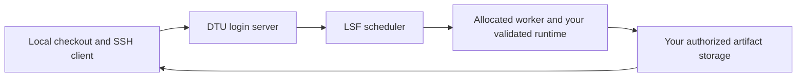

# Codex and DTU HPC integration

Reviewed 22 October 2026. Start with [DTU HPC setup for your own account](HPC_GUIDE.md).
The earlier guide described one workstation and its private storage. That
[dated snapshot](history/codex_dtu_hpc_workstation_20261016.md) is retained as
history, not reusable configuration.

## Where the work runs

Codex edits the local checkout and can invoke SSH/SFTP/SCP clients available to
that execution environment. LSF schedules project scripts on DTU workers. This
workflow does not require installing Codex on HPC or keeping credentials in Git.

Local/Worktree Codex environments run on your computer. Cloud environments do
not automatically inherit your computer's VPN, keys, processes or files. Check
the environment in use before assuming SSH access.
[Official OpenAI documentation: environments](https://learn.chatgpt.com/docs/environments/modes).

## Identity, source and execution

1. Configure your own SSH alias, DTU account and authorized storage using the
   [HPC guide](HPC_GUIDE.md). Another workstation's SSH configuration is not
   inherited by cloning a repository.
2. Read root [AGENTS.md](../AGENTS.md), the owning experiment README and its
   history. OpenAI describes layered project instructions in its
   [AGENTS.md guidance](https://learn.chatgpt.com/docs/agent-configuration/agents-md).
3. Prepare local changes and seal actual bytes with the
   [canonical packager](../scripts/releases/package_stage0_release.py).
   A commit ID alone does not identify uncommitted overlays.
4. Transfer to a fresh authorized source location and authenticate it with the
   [verifier](../scripts/releases/verify_stage0_release.py) and independently
   recorded manifest hash. Preserve previous source and output directories.
5. Run only authorized allocated stages. Inspect launcher roots/interpreters:
   many controllers remain account-bound; example environment variables do
   not override their pinned constants.
6. Retain actual submission responses, source/config/input/runtime identities,
   logs and failures. Download and verify evidence, then update the
   [experiment logbook](experiment_ledger.md).

Editing local files or pushing Git does not update an immutable HPC release.
An accepted batch job is independent of the original SSH session. A lost
submission response can still mean the job was accepted; inspect receipts and
scheduler state before retrying. Continued work needs a real authorized
controller or callback; an inactive chat alone schedules nothing.

Keep Mosaic and other projects in separate roots you may access. The old
sibling-project worker path was one operator's installation; other users need
their own validated worker or an explicitly shared installation.

## Troubleshooting boundary

Use [DTU access guidance](https://www.hpc.dtu.dk/?page_id=2501) for network/key
setup. The historical snapshot describes one Windows VPN incident. Ending a
client process is not a universal diagnosis or permission for an agent to
interrupt the user's connection.

This documentation review made no HPC connection, submission, VPN/key change,
remote permission change or numerical acceptance claim.
