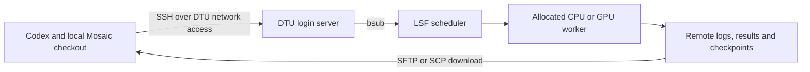

# Historical workstation setup - 16 October 2026

This account-specific description is retained as history, not shared setup guidance. Private paths describe the original operator. Use [the maintained HPC guide](../HPC_GUIDE.md). Relative links below are rebased for this snapshot directory; the original byte copies remain in the local documentation-audit backup.

---

# Codex and DTU HPC integration

Documented on 16 October 2026 from the workstation's SSH configuration and the
project's launchers, release tools and experiment records. This document does
not establish a live VPN connection, current queue state or a new HPC result.

Codex prepares and coordinates work through its Windows app and local tools.
DTU HPC runs the numerical workload. The connection between them uses standard
SSH, file transfers and DTU's LSF job scheduler.



## What runs where

| Component | Location | Role |
| --- | --- | --- |
| Codex app and file/shell tools | Windows workstation | Read instructions, edit code, prepare releases, send commands and interpret returned evidence. |
| Cisco Secure Client | Windows workstation | Provide DTU network access from off campus through `vpn.dtu.dk`. |
| OpenSSH client | Windows workstation | Authenticate to DTU, execute remote commands and transfer files. |
| DTU login server | `login1.hpc.dtu.dk` | Handle remote shell access, file management and scheduler commands. Numerical experiments belong in allocations. |
| LSF scheduler | DTU HPC | Queue jobs, allocate resources and track their states. |
| Python and model runtime | Allocated DTU workers | Run preprocessing, numerical tests, inference, optimization or training within the authorized experiment scope. |
| Project storage | `/work3/s234818/mosaic` | Hold environments, model assets, immutable releases, run outputs and evidence. |

This workflow does not require Codex to be installed on HPC. The remote
processes are project scripts and model runtimes. Whether a separate Codex CLI
installation happens to exist on the cluster has not been checked.

## VPN, username and SSH authentication

The workstation's `~/.ssh/config` defines the `dtu-hpc` alias. Its relevant
settings are equivalent to:

```sshconfig
Host dtu-hpc
    HostName login1.hpc.dtu.dk
    User s234818
    IdentityFile ~/.ssh/dtu_hpc
    ServerAliveInterval 60
```

Consequently, `ssh dtu-hpc` already knows the server, username and key file.
The username does not need to be supplied in every command.

There are two separate authentication steps:

1. **VPN:** the user completes DTU's password and MFA prompts in Cisco or Windows.
2. **SSH:** the client uses the private key on the workstation to prove possession
   of the key corresponding to an authorized public key on DTU. The private key
   itself is not sent to the server. If it is encrypted and not already unlocked,
   the user may need to enter its passphrase locally.

Codex can invoke the configured SSH client without receiving the DTU password
in chat. Passwords, MFA codes, private keys and key passphrases do not belong in
the repository, release archives or experiment logs.

## From a local change to an HPC result

1. **Read the project context.** Codex uses the applicable instructions and
   project documentation to establish scope, execution rules and the last
   verified state. For Mosaic, the [Stage 0 usage guide](../stage_0_usage.md),
   [implementation plan](../stage_0_implementation_plan.md) and
   [experiment ledger](../experiment_ledger.md) describe the scientific workflow.

2. **Edit and seal locally.** Code and configuration are prepared in the local
   checkout. The [release packager](../../scripts/releases/package_stage0_release.py)
   captures current file bytes, including relevant uncommitted files, into a
   source archive with a file manifest and SHA-256 receipts. A Git commit is a
   reference; the archive and manifest identify the actual experiment source.

3. **Transfer and authenticate.** SFTP or SCP copies the release and its control
   files to DTU. A fresh release directory and a unique run directory prevent a
   new attempt from overwriting the identity or evidence of an earlier one.
   The [release verifier](../../scripts/releases/verify_stage0_release.py) checks source
   bytes against the externally supplied manifest hash before execution.

4. **Submit an allocated job.** Through SSH, Codex invokes the authorized LSF
   submission command. `bsub` returns a job ID; `bjobs` reports scheduler state.
   The launchers specify the required resources and use the resident runtime
   and model assets. Preparation, submission and queueing are separate from a
   successful numerical result.

5. **Execute and preserve evidence.** The allocated worker runs the requested
   checks or experiment, retaining source/configuration/model/context identities,
   logs, outputs and failures. Quota and source checks must pass before the
   numerical stage starts. Current Mosaic launchers use the dedicated
   `/work3/s234818/mosaic/envs/protenix-tiny` environment and staged assets.
   Reuse the exact environment and module settings recorded for the chosen run.

6. **Download and report.** Result archives and metadata are brought back to the
   workstation, with file and archive integrity checked before interpretation.
   Local evidence lives under `results/hpc/`; local release bundles live under
   `results/releases/`. Both are ignored by Git. The ledger records actual
   commands, job IDs, identities, outcomes and limitations.

Pushing Git commits does not upload an HPC release, submit a job or update a
running experiment. Likewise, editing local files does not modify a sealed
release already being used by a worker. Each transfer and submission is an
explicit step in the workflow.

## Project separation and automatic continuation

Mosaic uses `/work3/s234818/mosaic`. The separate DBMol project uses
`/work3/s234818/latentmol`, with its own releases, environments and run records.
They share the workstation's VPN and SSH access, but their configurations,
checkpoints and source identities must remain distinct.

Once LSF accepts a batch job, its execution does not depend on keeping this
chat, the SSH terminal or the workstation's VPN connected. Losing access can
prevent monitoring and result retrieval without stopping the submitted job.

Continuing across multiple allocations requires an explicitly submitted
controller or dependent callback. DBMol has such controllers that authenticate
completion, checkpoint lineage, health and quota before submitting another
serial segment. That behavior is not automatically inherited by Mosaic.
Mosaic's actual submitted jobs and any continuation mechanism must be checked
in its own receipts and ledger. A paused Codex conversation alone does not
provide ongoing monitoring or schedule the next experiment.

If an SSH connection drops while submitting a job, check saved submission
receipts and the scheduler before submitting again: the first job may already
have been accepted.

## VPN recovery observed on this workstation

On 7 October 2026, Windows reported error 628 and Cisco's logs showed repeated
VPN plug-in initialization failures. Stopping the stale `AnyConnect.exe`
process, reopening Cisco Secure Client and reconnecting allowed the user to
complete authentication; Windows then reported the HPC VPN as connected.
No VPN profile or GlazeWM configuration change was required.

If the same client failure recurs:

1. Open Task Manager with **Ctrl + Shift + Esc**.
2. In **Details**, find `AnyConnect.exe` and choose **End task**.
3. Reopen **Cisco Secure Client** from Start.
4. Open **Settings > Network & internet > VPN > HPC > Connect** and complete
   the DTU login and MFA prompts yourself.

Ending the client interrupts an active VPN connection. This recovery fixed the
observed stuck process; it does not establish the cause of every later VPN or
SSH error. Closing only the Cisco window can leave its background process running.

## References

- [OpenAI: project instructions with AGENTS.md](https://learn.chatgpt.com/docs/agent-configuration/agents-md)
- [OpenAI: local environments and project actions](https://learn.chatgpt.com/docs/environments/local-environment)
- [DTU: VPN setup](https://www.cc.dtu.dk/?page_id=5685)
- [Mosaic Stage 0 launcher](../../scripts/hpc/small_molecule_stage0.lsf)
- [Mosaic quota preflight](../../scripts/hpc/stage0_quota_preflight.py)
- [Mosaic experiment ledger](../experiment_ledger.md)
